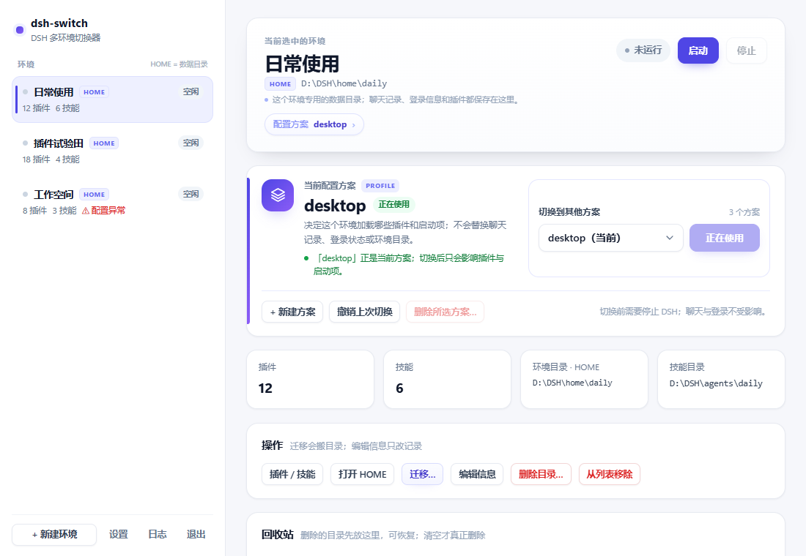

# dsh-switch

一个面向 Windows 的 **DSH 多环境管理器**：把聊天记录、登录状态、插件和配置方案隔离在不同目录中，并在它们之间快速切换。

> 非官方社区项目，与 DeepSeek / DSH 官方无隶属关系。

第一次使用请先读 [使用指南](docs/USAGE.md)；数据范围见 [隐私说明](docs/PRIVACY.md)。



## 功能

- **多环境管理**：列出、创建、编辑、迁移和移除 DSH 环境。
- **一键切换**：启动、停止，或先关闭当前环境再用另一套环境启动。
- **配置方案（profile）**：在同一个环境内切换插件组合，不更换聊天记录和登录状态。
- **环境迁移**：复制并校验目录后才更新记录；原目录可保留，也可移入回收站。
- **安全删除**：环境目录先进入管理器回收站，可在界面中恢复。
- **插件 / 技能盘点**：只读查看每个环境里安装了哪些插件和技能。
- **桌面快捷方式管理**：只处理 DSH 相关快捷方式。
- **纯本地运行**：dsh-switch 本身没有账号体系、遥测或远程 API 调用。

## 适用场景

- 工作、个人、测试等 DSH 数据需要完全隔离，登录状态和聊天记录互不干扰。
- 想试用新插件或新配置，又不想污染日常使用的环境。
- 同一个 HOME 下需要在多套插件/启动项组合之间切换（profile）。
- DSH 环境太大，需要迁移到另一块本机磁盘，同时要求复制、校验和失败回退。
- 想快速盘点每个环境的插件、技能和 DSH 相关桌面快捷方式。

## 不适用场景

- 不是 DSH 安装器、更新器或账号共享工具。
- 不提供云同步、远程访问或多用户服务。
- 不能保证第三方 DSH 修改版和所有插件的兼容性。
- 不能替代你自己的备份，也不会自动合并两个正在使用的 HOME。

## HOME 与配置方案

- **HOME / 环境**：一套独立的 DSH 数据目录，包含聊天记录、登录信息、插件和 `profiles`。
- **配置方案（profile）**：同一环境内的一套插件和启动项组合。切换 profile 不会切换 HOME，也不会清空聊天记录。

环境目录放在哪里由用户决定。管理器只保存路径，不强制使用固定磁盘或固定父目录。

## 系统要求

- Windows 10 / 11，64 位
- PowerShell 5.1
- .NET Framework 4.8
- 桌面版需要 Microsoft Edge WebView2 Runtime
- 已安装 DeepSeek Harness（或其兼容发行版）

## 快速开始

1. 下载发布包并解压到一个可写目录。
2. 双击 `Start.cmd`。
3. 首次启动时，在“设置”中确认 `DeepSeek Harness.exe` 的路径。
4. 新建环境或选择一个已有 HOME，然后点击“启动 / 切换”。

源码目录下如果没有构建好的 `app\dsh-switch.exe`，`Start.cmd` 会自动使用浏览器界面（Edge App 模式或默认浏览器），不需要先安装开发工具。

发布包内的 `Start-Visible.cmd` 用于保留控制台窗口，方便排查启动错误；日常使用仍然双击 `Start.cmd`。

### 从源码构建桌面版

以下步骤请在源码仓库中执行；发布包只包含运行所需的文件。

```powershell
powershell -NoProfile -ExecutionPolicy Bypass -File .\scripts\build-app.ps1
```

脚本会从 NuGet 恢复固定版本的 WebView2 SDK，并使用系统自带的 .NET Framework 编译器生成 `app\dsh-switch.exe`。

已有 WebView2 程序集时可以离线构建：

```powershell
powershell -NoProfile -ExecutionPolicy Bypass -File .\scripts\build-app.ps1 -WebView2Dir <包含 DLL 的目录>
```

构建完成后再次运行 `Start.cmd`，会优先打开桌面版。

## 推荐使用方式

1. 先关闭 DSH，并备份重要的 HOME、agents 和 `%APPDATA%\dsh-manager`。
2. 在“设置”里确认 DSH 程序路径。
3. 用“新建空白环境”建立测试环境，或用“添加已有环境”登记原有 HOME。
4. 切换环境前保存工作；DSH 会被关闭后用目标环境重新启动。
5. 需要搬目录时使用“迁移…”，不要手动改实例表或直接剪切正在使用的 HOME。
6. 确认新位置能正常启动后，再处理原目录或回收站。

完整的逐项操作、备份/卸载和故障排查见 [使用指南](docs/USAGE.md)。

## 使用前必看

- **先备份**：迁移、切换、删除都涉及真实目录；管理器回收站不是外部备份。
- **先停 DSH**：不要在 DSH 运行时修改 HOME、agents 或 `profiles\desktop`。
- **不要放同步盘**：正在使用的 HOME 不建议放在 OneDrive、网盘或网络磁盘。
- **迁移默认保留源目录**：确认新目录可用后再手动清理；移入回收站也不等于永久删除。
- **区分移除与删除**：“从列表移除”只删记录；“删除目录”会把目录移入管理器回收站。
- **不要开启排障后门**：`disable-auth.txt` 会关闭本地 API 来源检查，日常不要创建。
- **分享日志先脱敏**：日志可能包含 Windows 用户名、HOME 路径和 DSH 安装路径。

## 验证

以下命令在源码仓库中运行；发布包不包含自检脚本。

```powershell
powershell -NoProfile -ExecutionPolicy Bypass -File .\verify.ps1
```

包含静态检查、资源完整性检查和本地 HTTP 冒烟测试。完整构建检查：

```powershell
powershell -NoProfile -ExecutionPolicy Bypass -File .\verify.ps1 -BuildApp
```

冒烟测试会启动一个仅监听 `127.0.0.1` 的临时服务。如果当前终端禁止 Windows
HTTP 服务（例如受限沙箱），脚本会给出明确提示；请在普通桌面 PowerShell 中重试，
或先使用 `-SkipSmoke` 完成静态检查和构建检查。

## 目录结构

```text
app/                 构建输出（不提交）
lib/core.ps1         路径、进程、环境、profile、迁移等业务逻辑
web/                 本地界面、HTTP 服务、看门狗
src/native/          C# 桌面外壳源码
scripts/             构建、冒烟测试和发布打包脚本
docs/                架构、使用指南、隐私说明与截图
verify.ps1           仓库自检入口
```

## 数据位置

- 管理器配置与日志：`%APPDATA%\dsh-manager`
  - 保留旧目录名是为了兼容已有安装；界面和程序名是 `dsh-switch`。
- 环境 HOME：由用户创建或选择，管理器不会强制迁移到统一目录。
- 环境回收站：`%APPDATA%\dsh-manager\trash`

`instances.json`、`current.json`、日志和浏览器运行时目录都不会进入版本库。

## 安全与隐私

- HTTP 服务仅监听 `127.0.0.1`，不会暴露到局域网。
- `/api/*` 接口有同源 / 自定义请求头检查，阻止普通网页跨站调用。
- 不需要管理员权限。
- dsh-switch 本身不包含遥测、自动更新或远程服务。
- 删除环境时先移入管理器回收站；迁移时会先复制并校验。
- WebView2 使用独立的本地数据目录；Edge 浏览器模式和桌面版互不影响。

更多说明见 [使用指南](docs/USAGE.md)、[隐私说明](docs/PRIVACY.md) 和 [SECURITY.md](SECURITY.md)。

## 已知限制

- DSH 桌面端同一时间只允许一个窗口，因此“切换环境”本质上是关闭后重新启动。
- 部分 DSH 版本会忽略 `DSH_PROFILE`，管理器通过 Windows junction 管理桌面端的 profile。
- 当前发布构建面向 Windows x64；未签名 exe 可能触发 SmartScreen 提示。
- 本项目不修改已安装的 DSH 程序文件。

## 常见问题

### 启动后一片空白，或提示后台服务已断开

先关闭管理器，再双击 `Start.cmd`。仍失败时查看
`%APPDATA%\dsh-manager\dsh-manager.log` 和 `%TEMP%\dsh-manager\native.log`，
并确认 WebView2 Runtime 与安全软件没有拦截本地 `127.0.0.1` 服务。

### 找不到 DeepSeek Harness.exe

在“设置”中手动选择。非标准安装、修改版或便携版可能无法被自动探测。

### 为什么切换 profile 前必须停止 DSH

profile 入口可能由 junction 维护，运行中改入口会导致插件和启动项状态不一致。

### 项目放在带空格的目录会坏吗

当前版本已处理带空格的路径，可以正常启动。升级后建议完全退出旧管理器再重新打开。

## 开发

- 使用指南：[docs/USAGE.md](docs/USAGE.md)
- 隐私说明：[docs/PRIVACY.md](docs/PRIVACY.md)
- 架构说明：[docs/ARCHITECTURE.md](docs/ARCHITECTURE.md)
- 变更记录：[CHANGELOG.md](CHANGELOG.md)
- 贡献指南：[CONTRIBUTING.md](CONTRIBUTING.md)
- 第三方组件：[THIRD_PARTY_NOTICES.md](THIRD_PARTY_NOTICES.md)

## English

dsh-switch is an unofficial Windows utility for managing isolated DeepSeek Harness environments, switching plugin profiles, and migrating environment directories safely. It runs locally, binds only to loopback, and contains no telemetry or external network calls.

## License

[MIT](LICENSE)
